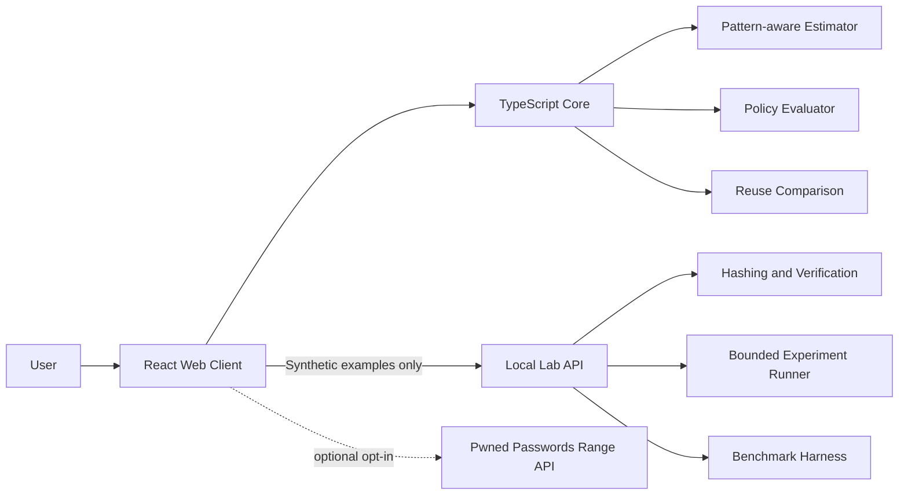

# Architecture and Engineering Design

## 1. Architecture goals
- Keep the password-analysis path small, local and auditable.
- Isolate cryptographic demonstrations and attack simulations from user-facing SDKs.
- Make every boundary typed, validated and testable.
- Avoid persistence and authentication infrastructure unless justified by a future approved requirement.

## 2. Logical architecture



The local analyzer must not call the Lab API. Optional HIBP lookup is a separate opt-in action and must never receive a plaintext password or complete hash.

## 3. Repository layout

```text
password-security-lab/
├── apps/
│   ├── web/                 # React + TypeScript interface
│   └── lab-api/             # Python FastAPI, loopback only
├── packages/
│   ├── core/                # Pure analysis and policy contracts
│   └── react/               # Optional React components
├── data/
│   ├── fixtures/            # Synthetic-only demonstration fixtures
│   └── wordlists/           # Licensed, versioned demo wordlists
├── docs/
├── tests/
│   ├── unit/
│   ├── integration/
│   ├── security/
│   └── acceptance/
├── .github/workflows/
├── package.json
├── pnpm-lock.yaml           # or one chosen package manager lockfile
├── pyproject.toml
└── README.md
```

Do not maintain multiple competing lockfiles or duplicate implementations of scoring logic.

## 4. Component ownership

### Web client
Owns user input, masked field, navigation, explanations, accessible feedback and optional calls to the local lab. It must not persist password values or include them in telemetry.

### Core package
Pure TypeScript; no React, browser storage, network, Python, filesystem or lab dependencies. It owns:
- estimator adapter,
- structured finding normalization,
- policy evaluation,
- short-lived sample-set reuse analysis,
- stable result types.

### Lab API
Local Python service for synthetic-only hashing, verification, bounded experiments and measurements. It is not an Internet-facing service. Bind to loopback and fail closed if configured otherwise.

### Data assets
Every dataset must have source, license, version, date, checksum and update procedure. If provenance cannot be verified, do not ship it.

## 5. Data-flow constraints
1. Analyzer input remains in browser memory.
2. Core returns a result that excludes the raw password.
3. The lab receives only synthetic demonstration inputs.
4. HIBP request contains only the first five hex characters of a locally computed SHA-1 hash.
5. Exports contain settings and outcomes only; no entered sample, target plaintext or candidate list.

## 6. Suggested core contracts

```ts
export type CheckState = "pass" | "fail" | "not_checked" | "unavailable";

export interface Finding {
  id: string;
  severity: "info" | "warning" | "critical";
  title: string;
  explanation: string;
  recommendation?: string;
}

export interface AnalysisResult {
  estimator: { name: string; version: string; method: string };
  score?: number; // presentation aid only; not a cryptographic guarantee
  band: "very_weak" | "weak" | "moderate" | "strong" | "very_strong";
  guessability?: {
    estimatedGuesses?: number;
    confidence: "low" | "medium" | "high";
    assumptions: string[];
  };
  findings: Finding[];
  suggestions: string[];
  inputLength: number;
  // The original password MUST NOT be returned.
}

export interface PolicyCheck {
  id: string;
  label: string;
  state: CheckState;
  rationale: string;
}

export interface PolicyResult {
  policyId: string;
  policyVersion: string;
  checks: PolicyCheck[];
  overall: "compliant" | "non_compliant" | "incomplete";
  disclaimer: string;
}

export function analyzePassword(
  password: string,
  options?: { locale?: string }
): AnalysisResult;

export function evaluatePolicy(
  password: string,
  policyId: string
): PolicyResult;
```

The API is illustrative until the team chooses and pins the estimator. Do not invent estimator confidence values; map only what the selected library actually supports and label project heuristics.

## 7. Local lab API boundary

The API accepts only schema-validated demonstration requests. It should:
- bind to `127.0.0.1`,
- reject non-loopback deployment configuration,
- restrict CORS to the exact local frontend origin,
- use fixed algorithm identifiers and bounded parameter ranges,
- accept synthetic fixtures or session-generated values only,
- keep job state in memory with TTL,
- avoid logging request bodies,
- reject arbitrary hashes and external targets.

Detailed endpoint contracts are in `07-API-CONTRACTS.md`.

## 8. Failure behavior
- Missing lab service: analyzer remains functional; lab screens show unavailable.
- Invalid parameters: reject with safe, actionable error.
- Timeout: return `time_limit`, not success.
- User cancellation: stop promptly and return `cancelled`.
- HIBP unavailable: return `unavailable`, never `not_found`.
- Oversized input: reject explicitly; do not silently truncate.

## 9. Technology choices
The existing team plan proposes React/TypeScript for the web/core and Python/FastAPI for the local lab. This is a coherent split. Confirm exact versions and libraries through a small dependency review before implementation. Prefer maintained libraries, narrow dependency sets, lockfiles and reproducible builds.

## 10. Architecture decision gates
Before coding, approve:
- estimator and version,
- dataset provenance/license,
- maximum input sizes,
- local API origin/port and CORS policy,
- supported runtimes,
- benchmark methodology,
- export format and whether external breach lookup is in release scope.
