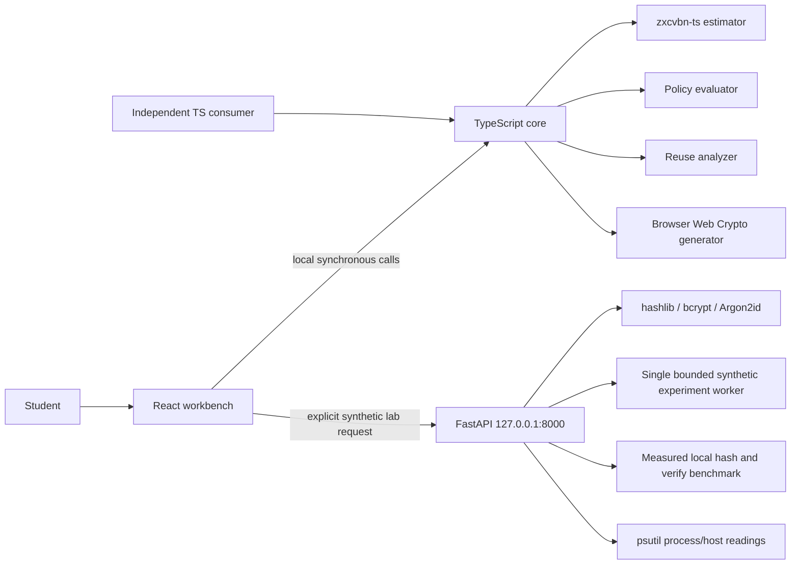

# Architecture

## Product shape

The laboratory consists of a framework-independent TypeScript core, a React/Vite
browser application, and a separate local FastAPI service. `packages/core` does not
import React, Python, the HTTP client, storage, or attack functionality. The Python
service is for explicit lab operations only. A standalone SDK-consumer workspace
demonstrates the core package boundary.

## Modules and responsibility

| Module | Responsibility | Trust boundary/dependencies |
|---|---|---|
| `packages/core/src/analyze.ts`, `estimator.ts` | Pattern-aware estimate, findings and recommendations | Local pure analysis; zxcvbn-ts language data |
| `packages/core/src/policy.ts` | Independent modern/educational rule checks | Local synchronous input; bundled common dictionary data |
| `packages/core/src/reuse.ts` | In-memory exact/similarity examples | No API/storage; result identifies indices, not values |
| `packages/core/src/generate.ts` | Secure random character/password phrase generation | Web Crypto only; caller receives value, no persistence |
| `apps/web/src/App.tsx` | UI state and explicit API calls | Fixed loopback base URL; password fields are not put in URLs |
| `apps/web/src/components` | Navigation, status meters, operational rail, topology and event console | Render measured API/service state; no Docker dependency |
| `apps/web/src/features` | Analysis, hash, attack, benchmark/report and learning screens | Calls shared core or explicit API service; no duplicate policy logic |
| `apps/lab-api/app/schemas.py` | Strict API request validation | Explicit finite fields/strategies; no extra request keys |
| `apps/lab-api/app/crypto.py` | Hash and verifier formats | Established native Python libraries; bounded KDF parameters |
| `apps/lab-api/app/attacks.py` | Candidate ordering and bounded checking | Fixed internal synthetic targets; actual verifier per candidate |
| `apps/lab-api/app/state.py` | Short-lived job/verifier state and locks | Process memory only, bounded count/TTL |
| `apps/lab-api/app/benchmark.py` | Warmed real measurements and machine metadata | Synthetic constant sample; no user input |
| `apps/lab-api/app/main.py` | Local API, middleware, lifecycle, routes, health measurements | Loopback launcher, Host/Origin/CORS/body rules |

## Trust boundaries

1. **Browser-local analysis:** the analyzer and policy/reuse functions run in the
   browser. They make no request to the API or external endpoint.
2. **Explicit laboratory requests:** the storage and attack screens submit made-up
   demonstration input to a fixed `127.0.0.1:8000` service. The API does not accept
   imported hashes, arbitrary account records, files, lists, or network targets.
3. **Experiment worker:** one bounded worker checks deterministic internal target
   candidates using actual verifier calls. Cancellation/time checks are cooperative
   around native KDF work.
4. **Short-lived state:** generated verifier and experiment records are held only in
   bounded process memory and expire. The API has no database or account identity.
5. **GitHub automation:** workflows have read-only repository permissions except
   CodeQL's `security-events: write`; no deployment or package publish permission is
   configured.

## Local operations and API

The development web server listens at `127.0.0.1:5173`. The API launcher listens at
`127.0.0.1:8000`, disables request access logging, and exposes local `/docs`,
`/redoc`, and `/openapi.json`. CORS accepts only the web origin. Health readings are
sampled from psutil and describe the API process/host rather than containers.

The UI's operational shell includes 11 real modules. Quick actions navigate or run
the relevant functionality; browser limitations such as inability to start/stop an
OS process are reported as copyable local commands, not represented as a process
control.

## Important limitations

- There is no public deployment architecture, multi-user isolation, persistence,
  telemetry, or Docker Compose setup.
- The current React integration has not passed a build/browser run because npm
  resolution is blocked in the supplied environment. Code boundaries are implemented
  in source but not runtime-verified.
- The approved screenshot file was absent; the layout follows the written reference
  description. See [UI Verification](UI-VERIFICATION.md).
- The API is an educational local process and must not be exposed on a public host.

See [Data Flow](DATA-FLOW.md), [Module Responsibilities](MODULE-RESPONSIBILITIES.md),
[Security Architecture](SECURITY-ARCHITECTURE.md), and [API Reference](API-REFERENCE.md).
