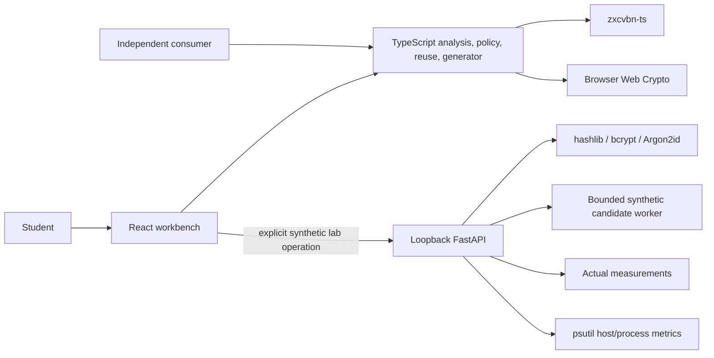

# Final Engineering Report

**Date:** 2026-11-15  
**Delivery state:** Partial implementation; mandatory P0 acceptance is not complete.  
**Evidence rule:** Each status applies only to the command or behavior explicitly named.

## 1. Executive summary

The partial product was audited and preserved. Work added a refactored light-first
technical workbench, a local Web Crypto generator, guided labs, current operational
health data, six bounded attack strategies, measured candidate throughput, expanded
API docs/contracts, Git hygiene, GitHub CI/security/release workflow definitions,
and synchronized status/security/UI documentation. The current acceptance pass also
updated the root development launcher to build/watch the core before Vite and refined
the workbench source. The Python API and checks pass 49 behavior tests. The overall
product is **not release-ready** because npm cannot
resolve packages in this environment; TypeScript, SDK, React, browser, clean install,
and workflow execution remain unverified.

## 2. Original repository state

The latest audited baseline was a meaningful partial product: Python crypto/API,
attack and benchmark modules/tests; TypeScript analysis/policy/reuse; React four-page
source; and an SDK example. The Python baseline had 40 passing tests. A separate
older `INITIAL-REPOSITORY-AUDIT.md` captured an earlier docs-only workspace and is
superseded for this assignment by [Final Repository Audit](FINAL-REPOSITORY-AUDIT.md).
The approved screenshot, separately mentioned latest-project ZIP, historical PRD
PDF, and Project Overview/Abstract PDF were not accessible in the workspace.

## 3. Final architecture

The core is independent of React, Python, persistence, network, and attack logic.
The UI calls the same core and submits only explicit local lab operations. The API
binds to `127.0.0.1:8000`, holds bounded verifier/job records in process memory, and
has no database, account service, or public deployment configuration.

## 4. Features implemented

- Pattern-aware analyzer and independent modern/educational policy profiles in core.
- Exact/similarity reuse analysis and Web Crypto password/passphrase generation.
- SHA-256 baseline, PBKDF2-HMAC-SHA256, bcrypt and Argon2id generation/verification.
- Deterministic dictionary, brute force, pattern, suffix, substitution and two-word
  combination checks against internally selected synthetic targets.
- Repeated benchmark and API health measurements; actual candidate verification time
  and throughput for attack jobs.
- React source for overview, topology, analysis, policy, reuse, generator, hashing,
  attack, benchmarks, reports, and guided learning areas.
- OpenAPI docs, plural benchmark route alias, local operational panels, and session
  JSON/CSV export source.
- Local core consumer example and build/test scripts are present but unverified.

## 5. Deferred features

- P1 Have I Been Pwned range-protocol exposure check.
- Docker Compose; process-based localhost architecture is retained.
- Public SDK publishing, public deployment, and public release.
- PDF export and production multi-user/session persistence.

## 6. Files and modules changed

Changes are grouped under `apps/lab-api` (health/OpenAPI/attack strategies and API
tests), `packages/core` (secure generator and tests), and `apps/web` (shell, feature
views, operational panels, themes, selectable service inspection and responsive CSS).
The root `scripts/dev.mjs` launcher builds and watches the core before starting Vite.
Repository infrastructure
includes `.gitignore`, `.gitattributes`, `.editorconfig`, `.github/workflows`,
Dependabot and PR template, plus `scripts/release-check.mjs`. Documentation and
status include audit/reconciliation/traceability, architecture/data flow, API,
security/privacy, UI/CI/Docker, testing, limitations, and this report.

The verified archive `artifacts/pre-implementation-checkpoint.zip` remains present;
its recorded SHA-256 is
`1E16752E3006A1EB65BC03A9BBA56D550FAE83E740D18879A1C71950A2801AE3`.

## 7. Dependencies

Python runtime pins include FastAPI 0.128.0, Uvicorn 0.40.0, argon2-cffi 25.1.0,
bcrypt 5.0.0, Pydantic 2.12.5, and psutil 7.2.2. Test/tool pins include pytest
9.0.2, httpx 0.28.1, and Ruff 0.16.2. Exact version requirement files exist but
contain no artifact hashes; no clean isolated installation was completed.

JavaScript manifests pin zxcvbn-ts core/common/en 4.2.0, React/React DOM 19.3.0,
Lucide 1.72.0, TypeScript 5.9.3, Vite 7.2.2, Vitest 4.0.8 and related tooling.
These dependencies were not installed or inspected at runtime. There is no
`package-lock.json`; package compatibility/advisories and transitive resolution are
unverified. GitHub workflow action refs are pinned to immutable commit SHAs.

## 8. API reference

Implemented routes: `GET /lab/health`; `POST /lab/hash`; `POST /lab/verify`;
`DELETE /lab/hash/{hash_id}`; `POST /lab/attacks`; `GET`/`DELETE /lab/attacks/{job_id}`;
`POST /lab/benchmark` and compatible `POST /lab/benchmarks`. Local OpenAPI UI is at
`/docs`; see [API Reference](API-REFERENCE.md) for schemas, limits, measured fields,
states, and errors. Python API behavior is covered by the passing test suite.

## 9. Security design

The API uses strict schemas, loopback/Host/Origin/CORS restrictions, body/input/KDF
limits, generated salts, random opaque IDs, bounded state and no request body/access
logging in its launcher. Attack targets are fixed internal fixtures; callers cannot
submit arbitrary hashes, lists, files, accounts or remote hosts. The browser analyzer
uses the local core; source boundary lint passes. Browser network/storage/console
inspection has not run.

## 10. Threat-model results

The local trust boundaries, synthetic-only target model, resource exhaustion controls,
secret leakage concerns, local API exposure, and dependency risks are documented in
[Threat Model](THREAT-MODEL.md) and [Security Architecture](SECURITY-ARCHITECTURE.md).
Selected Python behaviors passed regression tests. Frontend runtime, dependency
scans, process-level hard cancellation, and third-party penetration testing remain
unverified. No clean security audit is claimed.

## 11. Unit and API test results

- `python -m pytest -q` from `apps/lab-api/`: **PASSED, 49 tests in 38.22 seconds** on 2026-11-15.
- `ruff check apps/lab-api/app apps/lab-api/tests`: **PASSED**.
- `ruff format --check apps/lab-api/app apps/lab-api/tests`: **PASSED, 10 files**.
- `npm run lint` from repository root: **PASSED**, 7 core and 14 web files scanned; semantic token contrast checks passed at 4.5:1 in both themes.
- `node --check scripts/dev.mjs; node --check scripts/check-contrast.mjs`: **PASSED**.
- `npm run typecheck`: **BLOCKED/FAILED before source checking** because workspace dependencies are absent (`tsc` not recognized); npm install is blocked by offline cache/proxy constraints.
- `npm run dev`: **BLOCKED before launcher work** because `typescript` cannot be imported until JavaScript dependencies are installed. The launcher source passes `node --check`.
- `npm install --package-lock-only --ignore-scripts --no-audit --no-fund`: **FAILED with `ENOTCACHED`** for `@types/react`; no `package-lock.json` was produced.
- TypeScript/Vitest/core tests: **NOT RUN**, dependencies unavailable.

## 12. Integration and browser results

Python TestClient API integration exercises hashes, verification, synthetic attacks,
health, OpenAPI, benchmark alias, validation, limits and lifecycle. A fresh live
loopback session started with `python -m app.main` from `apps/lab-api`; `GET /lab/health`
returned `status=ok`, process ID 41924, measured CPU/RSS/memory, zero
active experiments and zero stored verifiers. Direct `/lab/hash` and `/lab/verify`
requests with a synthetic sample passed correct-password checks and rejected a
different sample for SHA-256, PBKDF2-HMAC-SHA256, bcrypt and Argon2id. All four demo
verifiers were deleted afterward. Six API attack strategies recovered their fixed
internal targets: dictionary 1/4 checks; brute force 5/6; pattern 4/5; suffix 5/5;
substitution 4/4; word combination 2/49. An Argon2id dictionary job was cancelled
and ended `cancelled` with zero candidates checked. `POST /lab/benchmark` completed
and its actual five-repeat measurements were saved in the latest benchmark artifact.

Current React-to-API integration, Playwright/browser E2E, navigation, result exports,
theme persistence, search, responsive behavior and analyzer network canary are
**NOT RUN**. No Chromium browser surface or runnable frontend bundle was available.

## 13. Security scan results

Ruff and project boundary lint passed. `pip-audit`, `npm audit`, Gitleaks, and CodeQL
were **NOT RUN locally**. GitHub workflow definitions are present but no GitHub
Actions run occurred. Scanner alerts and audit findings remain to be reviewed.

## 14. Actual benchmark results

The latest live API capture is
`artifacts/benchmarks/2026-11-15-acceptance-loopback.json`; the earlier real capture
`artifacts/benchmarks/2026-11-15-windows-local.json` is preserved. The latest run
used one warm-up and five measured generations/verifications per algorithm on
Windows 10, Python 3.10.11, a 12-logical-CPU Intel64 processor; available memory at
capture was 773,283,840 bytes. Values below are measured milliseconds (median, IQR):

| Algorithm and parameters | Hash generation | Verification |
|---|---:|---:|
| SHA-256 baseline | 0.006, 0.001 | 0.035, 0.003 |
| PBKDF2-HMAC-SHA256, 600,000 iterations | 581.678, 23.234 | 579.438, 69.343 |
| bcrypt, cost 10 | 179.944, 9.042 | 182.528, 10.103 |
| Argon2id, 19,456 KiB / time 2 / parallelism 1 | 105.554, 1.536 | 107.846, 7.264 |

These are actual measurements from one machine/run, not a general algorithm ranking
or estimated attacker throughput. No result was fabricated or extrapolated.

## 15. Clean installation

- npm install with `--ignore-scripts --no-audit --no-fund`: **FAILED** with `ENOTCACHED`
  because environment `NPM_CONFIG_OFFLINE=true` and the cache lacked packages.
- Process-only `npm_config_offline=false`: **FAILED** because the configured proxy
  `127.0.0.1:9` refused connection. No global/environment proxy setting was altered.
- pnpm offline resolution: **FAILED** with `ERR_PNPM_NO_OFFLINE_META` for Vite.
- A new Python venv was created at `apps/lab-api/.venv`; `pip install --no-index -r
  apps/lab-api/requirements-test.lock` **FAILED** because no pinned wheels (starting
  with `annotated-doc==0.0.4`) were cached. The venv is ignored by Git.

## 16. Requirement traceability

Detailed stable IDs, priority, module, status, test references, security evidence,
and acceptance evidence are in [Requirement Traceability](REQUIREMENT-TRACEABILITY.md).
The highest verified scope is Python API plus static boundary checks. TypeScript/UI/
SDK source must not be counted as functionally verified.

## 17. UI architecture and implementation

The workbench source has a compact top bar with a filled blue active tab, 11-module
sidebar and search, central feature workspace, right operational panels, and lower
topology/console/quick-action panels. Overview now has a selectable runtime table
and service-detail inspection pane. Violet and gold accents were removed. Light-first and dark
themes share semantic tokens. Source modules and layout
are documented in [UI Screen Architecture](UI-SCREEN-ARCHITECTURE.md) and
[Component Inventory](UI-COMPONENT-INVENTORY.md).

## 18. UI verification

TypeScript production build, rendered screenshots at 1648×928, 1440×900, 1024×768,
and 390×844, exact reference comparison, light/dark rendering, responsive layout,
keyboard navigation, screen-reader labels, measured contrast, and browser
network/storage checks are **NOT RUN**. The supplied screenshot and Chromium browser
surface were unavailable. CSS/source features are not acceptance evidence; see
[UI Verification](UI-VERIFICATION.md).

## 19. CI/CD

`ci.yml` covers Python 3.10–3.12, Ruff, pytest, npm boundary lint/typecheck/tests,
build and SDK consumer. `security.yml` configures pip-audit, npm audit, Gitleaks and
CodeQL. `release.yml` validates metadata, requires the npm lock, runs checks and
uploads a short-lived workflow artifact without publishing or deploying. Dependabot
and a PR template are configured. Workflow YAML parsed successfully and a Node check
confirmed 16 action references use full commit SHAs. The workflows are **NOT RUN** in
this local workspace; no Git remote is configured to run GitHub Actions. Regular CI
npm resolution remains dynamic until a lockfile exists.

## 20. Documentation inventory

Root documents include README, contribution/security/license/changelog and this
status. `docs/` includes audit, gap analysis, reconciliation/traceability,
architecture/data flow/modules/decisions, API, threat/security/privacy, UI/CI/Docker,
testing/benchmark, user/developer/SDK/deployment, troubleshooting, limitations,
demonstration, release, team responsibility and this report. Current evidence and
limitations are stated rather than inferred from source existence.

## 21. Team responsibility mapping

No team-member names or actual contribution records were supplied. The
[Team Contributions](TEAM-CONTRIBUTIONS.md) map assigns responsibility areas only;
it does not invent individuals or academic work attribution.

## 22. Demonstration instructions

Use only synthetic values and follow [Demonstration Guide](DEMONSTRATION-GUIDE.md).
After registry access is restored and UI verification passes: show predictable and
long-passphrase analysis; modern versus educational policy; duplicate/similar reuse;
secure generation; SHA-256 limitations and independent salts; PBKDF2/bcrypt/Argon2id
with correct/incorrect verification; actual bounded dictionary/brute-force and other
strategy checks; actual local benchmark observations and their limits; then discuss
privacy boundaries, cancellation limits, and residual risk. Do not present the UI
journey as completed until it has been run.

## 23. Known limitations

Primary limits include absent npm lock, no clean install, no browser/AT verification,
small educational dictionaries, heuristic reuse, cooperative cancellation, process-
local state without guaranteed string zeroization, no exposure check, and unconfirmed
license ownership. Details and rationale are in [Known Limitations](KNOWN-LIMITATIONS.md).

## 24. Git, preservation and release state

Local Git is initialized on branch `codex/password-laboratory`; it has no commits.
`.gitignore`, `.gitattributes`, `.editorconfig`, workflows, Dependabot, and a PR
template are present. No commit, push, tag, publication, deployment, or external
upload was made. The checkpoint remains intact.

## 25. Remaining risks and next steps

1. In a registry-enabled environment, resolve and review npm versions, commit the
   generated lock, generate Python artifact hashes, and clean-install both stacks.
2. Run Python and JavaScript CI and review all dependency/security findings.
3. Type-check and test core/UI/SDK, resolve actual failures, then run end-to-end
   browser journeys and analyzer privacy canary.
4. Compare screenshots against the approved image when available; perform keyboard,
   assistive-technology, contrast, and responsive review.
5. Stress-test cleanup and decide whether strict deadline enforcement requires
   terminable worker processes.
6. Confirm ownership, contributor rights, and course documents before any release.

## 26. Release readiness assessment

**NOT READY.** Python API and selected source/privacy checks have positive evidence,
but multiple mandatory P0 acceptance gates remain unverified or blocked. The release
workflow intentionally fails without `package-lock.json`; no public release or
deployment is configured. Current complete per-requirement status is in
[Implementation Status](../IMPLEMENTATION-STATUS.md).
