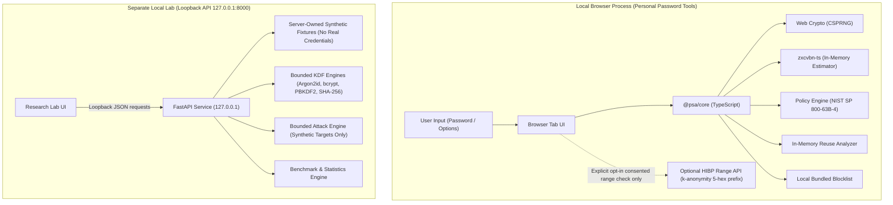

# Threat Model

## Scope and Assumptions

This model covers the local browser application, framework-independent TypeScript core (`@psa/core`), and separate loopback Python research laboratory (`apps/lab-api`). It assumes the user runs the application locally on their machine.

The application has two distinct trust domains:
1. **Personal Password Tools:** Processes real user passwords exclusively in ephemeral browser memory. It never makes network calls, writes to persistent browser storage, calls the Python API, or logs credentials.
2. **Research Lab:** Operates solely on server-owned or fixed synthetic fixtures and experiments. It never accepts, stores, or processes real user passwords, imported credential verifiers, or external targets.

## Assets

- User-entered personal passwords and ephemeral analysis results in local browser memory.
- Generated password material produced via Web Crypto CSPRNG in browser memory.
- Research Lab synthetic fixtures, synthetic attack targets, and benchmark measurements.
- Local host process availability, CPU/memory resources, and installed package integrity.

## Trust Boundaries & Architecture

**Architectural Invariant:** Personal Password Tools and the Research Lab are strictly decoupled. The Personal Password Tools have zero dependency on the Python API, and real passwords can never enter the Python API or network requests.

## Threats and Controls

| Threat | Impact | Controls in Source | Verification Method |
|---|---|---|---|
| Real user password leaves browser | Severe privacy loss | Core has zero network, storage, or logging dependencies; boundary linter enforces no API imports in Personal Tools | Architectural boundary lint, browser network canary test |
| Real password entered into Research Lab | Secret exposure | Research Lab API endpoints (`/lab/hash`, `/lab/verify`) accept server-owned `fixture_id` and `candidate_variant` identifiers only; no free-form password parameters exist | Pydantic schema validation tests, API unit tests |
| Weak or biased random generation | Password predictability | Mandatory `crypto.getRandomValues()` with rejection sampling for unbiased mapping; fail closed if CSPRNG unavailable | Core generator unit tests, PRNG source assertion |
| Password persisted in browser storage | Local credential leakage | Passwords never written to `localStorage`, `sessionStorage`, `IndexedDB`, cookies, or cache; only theme preference stored | Storage inspection tests, privacy canary |
| Remote site accesses loopback API (CSRF / DNS rebinding) | Unauthorized attack/KDF execution | API binds strictly to `127.0.0.1`; TrustedHostMiddleware allowlists only loopback hosts; CORS allowlists only exact local origins; mutation methods require trusted Origin/Referer | Adversarial HTTP request test suite |
| Resource exhaustion via expensive KDF or attack | Local denial-of-service | Hard server-side ceilings on KDF costs (Argon2 time <= 4, memory <= 64 MiB; PBKDF2 <= 1M iter; bcrypt <= 14); maximum attack attempt cap (10,000) and time cap (10s); single active job queue | API bounds tests, stress/concurrency test |
| Estimator or policy reveals secret in output | Information disclosure | `AnalysisResult` and `PolicyResult` schemas exclude original plaintext, matched substrings, or dictionary tokens; findings report only rule identifiers and educational explanations | Schema assertions, serialization tests |
| Supply chain / dependency compromise | Code injection / exploit | Pinned package locks, zero high/critical npm audit vulnerabilities, minimal dependencies | `npm audit`, license & dependency scan |

## Residual Risks

- **Memory Retention in Garbage-Collected Runtime:** JavaScript immutable strings cannot be reliably zeroized on demand; the application minimizes retention by avoiding caching and clearing state on navigation, but cannot guarantee forensic memory erasure.
- **Local Host Compromise:** Malware with administrative privileges or direct OS process inspection can inspect browser memory; the application does not defend against a compromised operating system.
- **Optional Breach Check Metadata:** When the user explicitly consents to the optional HIBP range check, the 5-character SHA-1 prefix and network IP are disclosed to the external service.
