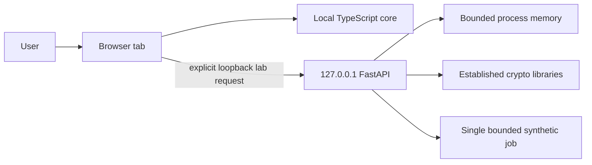

# Threat Model

## Scope and assumptions

This model covers the local browser app, framework-independent TypeScript core, and separate loopback Python lab. It assumes the user runs the development UI and API on the same machine and uses only synthetic examples. It does not cover compromised operating systems, malicious browser extensions, public deployment, account databases, or production authentication systems.

## Assets

- Analyzer input and transient analysis results in browser memory.
- Synthetic plaintext values submitted intentionally to the local storage lab.
- Generated verifiers, salts, benchmark output, and short-lived job records.
- Local machine availability and integrity of installed dependencies.

## Trust boundaries

The analysis core has no network or persistence dependency. The lab is a separate boundary: explicit storage actions send synthetic values to the local service. Attack requests identify only fixed internal targets; callers cannot submit target plaintext, imported verifiers, wordlists, filesystem paths, or remote hosts.

## Threats and controls

| Threat | Impact | Controls in source | Remaining verification |
|---|---|---|---|
| Analyzer input leaves the browser | Privacy loss | Core contains no network calls; UI sends only explicit lab requests to a fixed loopback origin; source boundary lint | Browser network canary is not run because the UI cannot currently be installed |
| Plaintext appears in app logs or error output | Secret disclosure | API validation errors are sanitized; access logs are disabled in launcher; request bodies are not logged; normal response schemas omit plaintext | Runtime browser and server log inspection still required |
| Remote site or hostile origin invokes local lab | Local operation abuse/CSRF-like request | Loopback bind, TrustedHost allowlist, exact CORS origin, mutation Origin guard | Browser cross-origin journey not tested |
| Expensive KDF or attack exhausts resources | Local denial of service | Cost ceilings, two KDF slots, one active attack, max body/input, max attempts/time, bounded state | Native KDF call cannot be interrupted; hard process kill and stress testing are not implemented |
| Caller turns lab into a real cracking tool | Credential compromise or abuse | Fixed synthetic target IDs and local candidate data; no import/remote target API | Source review and API tests pass; independent security review not done |
| Job IDs are guessed or jobs cross-contaminate | Result disclosure or control | Random opaque IDs, local in-memory records, one active job, strict identifier validation and TTL | TTL cleanup and concurrency stress test remain incomplete |
| Malicious dependency or vulnerable package | Code execution/privacy loss | Genuine npm lockfile; exact dependency versions; local lint/typechecks | Live npm audit after patched Vite 7.3.8/Vitest 4.1.12 reports zero findings; Python advisory scan not run |
| Weak/incorrect password storage implementation | Verifier compromise | Established libraries, per-hash random salts, stored parameters, constant-time comparison where applicable, malformed verifier checks | Cross-platform clean install and independent crypto review remain outstanding |

## Residual risks

This is not a complete security audit. Browser runtime behavior, dependency remediation, Windows process isolation, long-running cleanup, screen-reader accessibility, and default lifecycle installation remain unverified. Findings and evidence are tracked in [Security Audit](SECURITY-AUDIT.md) and [Privacy Verification](PRIVACY-VERIFICATION.md).
